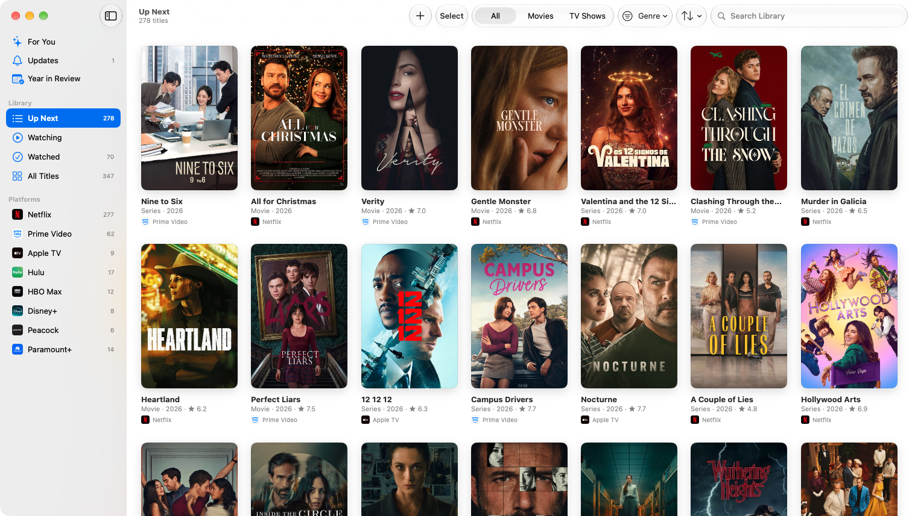
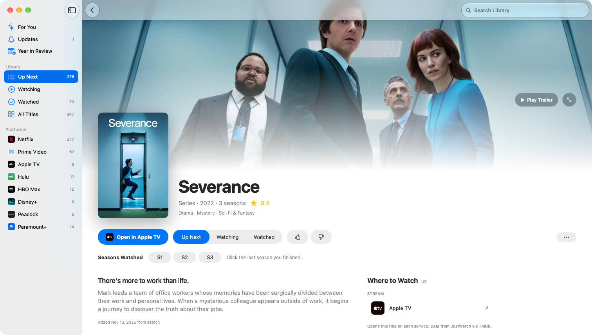
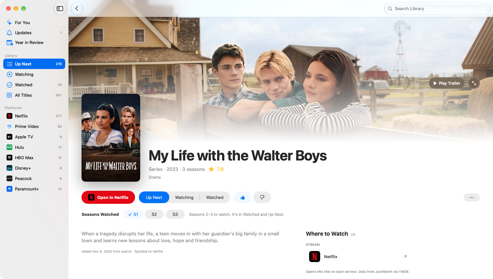
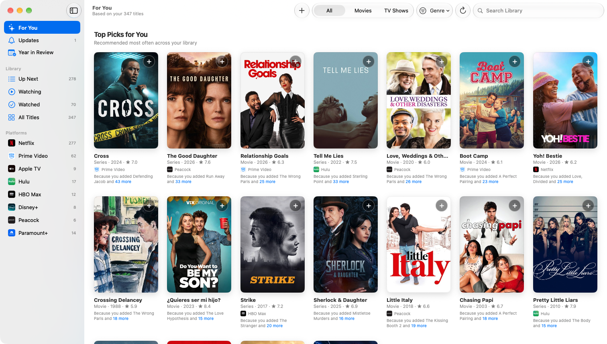
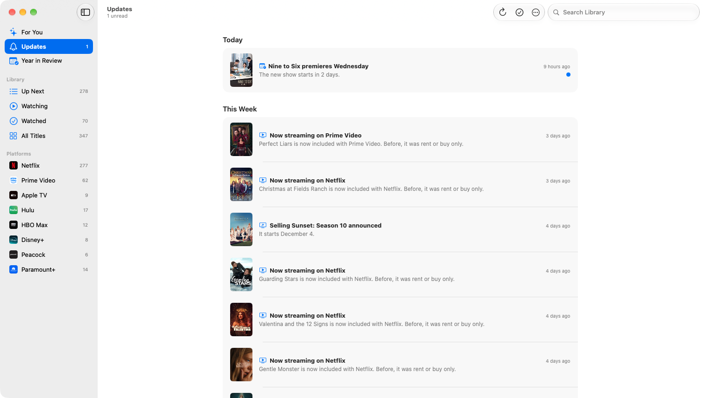
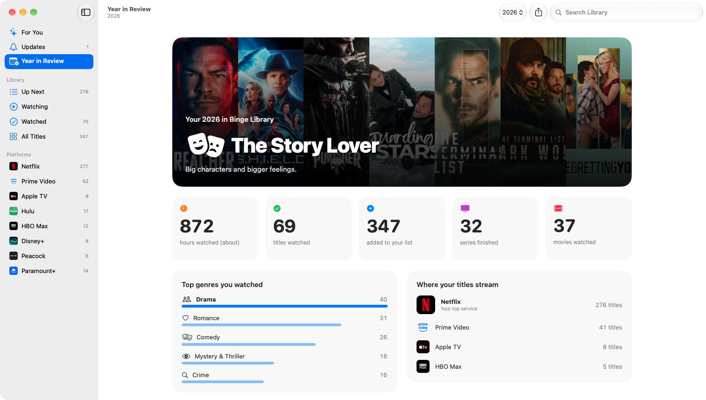

# 🍿 Binge Library

**Turn your streaming screenshots into a watchlist.** Binge Library is a native macOS app. Drop in screenshots from Netflix, Prime Video or Apple TV, and it finds every title in them and matches each one to [TMDB](https://www.themoviedb.org/). It shows where each title streams, recommends what to watch next, tells you when a new season or a subscription deal arrives, and lets AI agents on your Mac manage the library.

Built with SwiftUI and SwiftData for macOS 15 and later. The original web version (Node + React) is in this repository too.



## Screenshots

<table>
  <tr>
    <td width="50%"><br><b>Title page.</b> “Open in Apple TV” goes straight to the show, not a search.</td>
    <td width="50%"><br><b>Season progress.</b> Season 1 watched, seasons 2–3 still in Up Next.</td>
  </tr>
  <tr>
    <td width="50%"><br><b>For You.</b> Recommendations from your whole library, each with the reason.</td>
    <td width="50%"><br><b>Updates.</b> Every alert is kept, even after you dismiss the notification.</td>
  </tr>
  <tr>
    <td colspan="2"><br><b>Year in Review.</b> Hours watched, top genres and services, and a shareable card.</td>
  </tr>
</table>

---

## Features

### Capture
- **Screenshot recognition.** Drop, paste (⌘V) or drag screenshots onto the Dock icon. Every title in each image is found, including whole Netflix rows, along with the platform it was on.
- **Two recognition engines.** Google Gemini vision models, tried as a fallback chain with cooldowns for rate limits and outages, or Apple's on-device Vision OCR, which needs no key and works offline.
- **Review step.** Each match shows the top TMDB candidates, so a wrong guess takes one click to fix. You can also search TMDB and add any title directly.

### Library
- Up Next, Watching and Watched lists, plus per-platform views, a Movie/TV filter, sorting, search and 15 genre groups.
- **Where to watch** in your region, for Netflix, Prime Video, Apple TV, Hulu, HBO Max, Disney+, Peacock and Paramount+.
- **"Open in …" goes to the exact title page** on each service, not a search. Apple TV links open in the TV app.
- **Season-by-season progress.** A partly watched show appears in both Watched and Up Next. A finished show comes back to Up Next when a new season arrives.
- Multi-select for bulk changes, thumbs up/down, trailers, and full Undo/Redo.

### Personalization
- **For You.** Recommendations drawn from your whole library, weighted by what you've watched and liked. Each pick says why it was chosen, and thumbs-down titles are excluded.
- **Year in Review.** Hours watched, top genres and services, a monthly chart, your biggest binge, and a shareable image card.

### Alerts and Updates
- A daily check, which can run at login in the background, sends a notification when:
  - something on your list starts streaming with a subscription (instead of rent or buy only)
  - a show you follow announces a new season
  - a season premieres
- Every alert is also kept on the **Updates** page, so a dismissed notification is never lost.

### AI agents (MCP)
- A built-in [Model Context Protocol](https://modelcontextprotocol.io) server lets agents such as Claude search, add, update and get recommendations from your library.
  - It speaks Streamable HTTP on `127.0.0.1` only.
  - It needs a token stored in the Keychain.
  - It includes a stdio bridge command for agents that need one.
- Tools: `search_library`, `get_title`, `library_summary`, `search_tmdb`, `add_title`, `update_title`, `remove_title`, `get_recommendations`, `get_updates`.

---

## Getting started (Mac app)

**Requirements:** macOS 15+, Xcode 16+, and [XcodeGen](https://github.com/yonaskolb/XcodeGen) (`brew install xcodegen`).

```bash
git clone https://github.com/LakshyaSingh/binge-library.git
cd binge-library
mac/install.sh   # generates the Xcode project, builds a Release copy, installs it into /Applications
```

On first launch, open **Settings ▸ Services** and add:
- a **TMDB API key** (required, free): https://www.themoviedb.org/settings/api
- a **Gemini API key** (optional, free tier): https://aistudio.google.com/apikey. Without one, screenshots are read with Apple's on-device OCR.

Keys are stored in your Keychain. The library is stored in `~/Library/Application Support/Binge Library/`.

To work on the code, run `cd mac && xcodegen generate` and open `BingeLibrary.xcodeproj`. To build with your own Apple developer account, change `DEVELOPMENT_TEAM` and the bundle ID in `mac/project.yml`.

### Connecting an AI agent
In **Settings ▸ AI Agents**, turn on "Let AI agents use your library", then click **Copy HTTP Setup** or **Copy Command Setup** and paste the result into your agent's MCP configuration.

## Web version

The first version is a local web app, in `server/` and `web/`.

```bash
cp .env.example .env   # add your TMDB key (and optionally Gemini)
npm install
npm start              # http://localhost:5173
```

---

## Architecture

| Area | Technology |
|---|---|
| UI | SwiftUI, Observation (`@Observable`), Swift Charts, WebKit (trailers) |
| Data | SwiftData with an app-specific store; the model is CloudKit-compatible |
| Concurrency | async/await, task groups, main-actor isolation |
| Recognition | Gemini vision API (model fallback chain); Apple Vision OCR |
| Metadata | TMDB API: search, details, watch providers, videos, recommendations |
| Agent server | Network.framework (`NWListener`), JSON-RPC 2.0 over Streamable HTTP |
| System | Keychain, UserNotifications, ServiceManagement (login item) |

```
mac/
  BingeLibrary/
    Models/      Title, Platform, Genre
    Services/    AppModel, TMDB and Gemini clients, OCR, Recommender, LinkResolver,
                 AlertCenter, UpdatesStore, ImagePipeline, Keychain, MCP/
    Views/       Library, Add, Detail, For You, Updates, Year in Review, Settings
    Debug/       stall-test and scroll-benchmark harnesses
  BridgeTool/    stdio ⇄ HTTP bridge for MCP clients
  project.yml    XcodeGen project definition
server/, web/    original Node + React web version
```

### Engineering notes
- **Responsiveness.** Importing 50+ screenshots used to freeze the app. A built-in stall-test harness measured it. After moving image I/O off the main actor and limiting concurrency, the longest freeze went from **663 ms to 112 ms** and total frozen time from **4.8 s to 0.1 s**.
- **Scrolling.** Testing each feature on and off in a 300+ poster grid showed that hover tracking and logo rendering were the costs. Gating hover while scrolling and pre-rendering logos cut dropped frames from **6.8% to 2.5%**.
- **Data isolation.** The library uses its own store file. SwiftData's default store in a non-sandboxed app is shared with other apps, and another process once migrated it away. The titles were recovered from the raw SQLite pages.
- **Exact links.** TMDB only links to its own watch page. The app reads the outbound JustWatch links on that page, cleans them into each service's canonical title URL, and caches them.

---

## Credits
This product uses the TMDB API but is not endorsed or certified by TMDB. Streaming availability data is from JustWatch via TMDB. Screenshot recognition uses Google Gemini or Apple's Vision framework.
